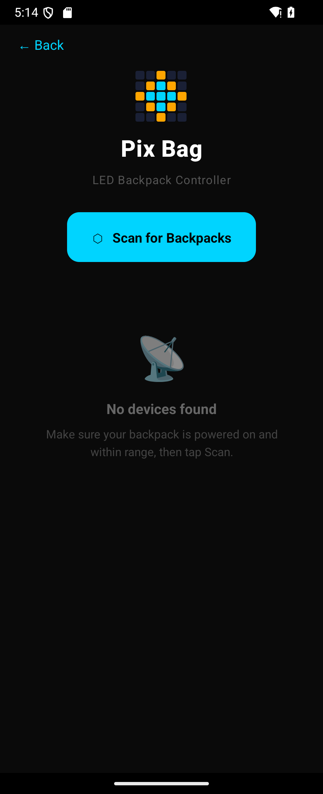
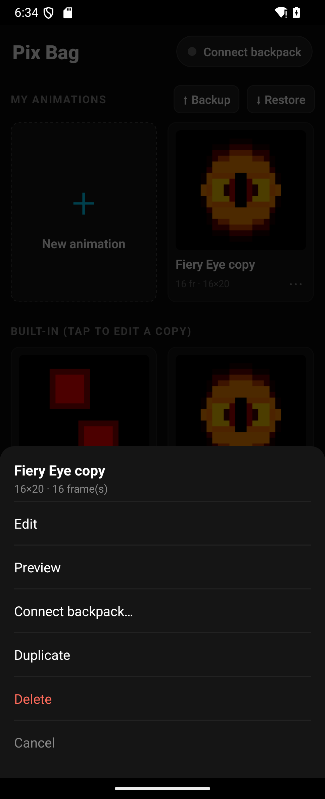
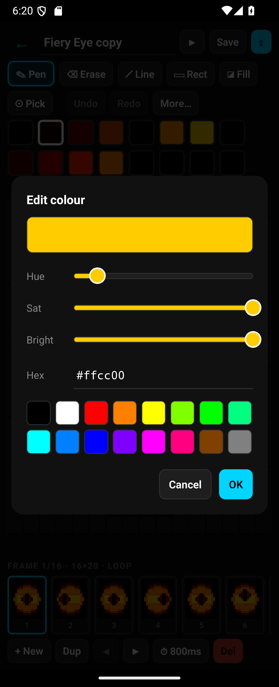
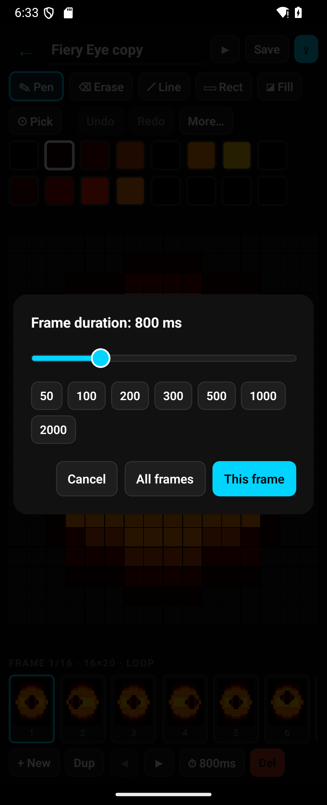
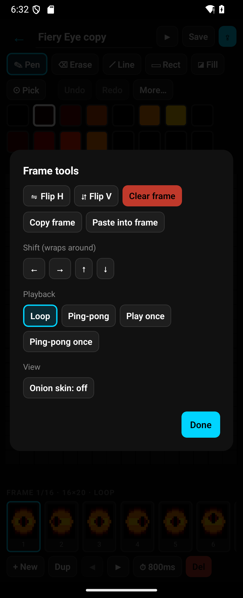
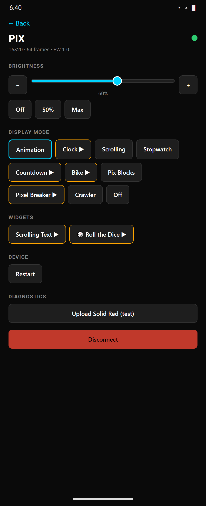

# Pix Bag user guide

Pix Bag lets you draw pixel animations on your phone and send them to your PIX LED backpack over Bluetooth. Everything is stored on your phone. No account is needed.

## Getting started

1. Switch the backpack on and turn on Bluetooth on your phone.
2. Open Pix Bag and tap the **Connect backpack** chip at the top right.
3. Tap **Scan for Backpacks** and allow the Bluetooth permission if asked. Scanning runs for about 10 seconds.
4. Tap your backpack in the list.

Next time, the Device page shows **Reconnect to &lt;name&gt;** so you can connect with one tap, without scanning.

The chip shows the connection state: grey = not connected, green = connected, red = link lost. If the link drops, Pix Bag tries to reconnect on its own. Otherwise open the Device page and tap **Reconnect**.

## Gallery

The home screen lists **My animations** and the **Built-in** animations.

- Tap **+ New animation** to start a blank one.
- Tap an animation to edit it. Built-ins open as a copy, so the original stays as it is.
- Tap `⋯` (or long-press the card) for more: **Edit**, **Preview**, **Upload to backpack**, and for your own animations **Duplicate** and **Delete**.

## Editor tools

The top bar has the name (tap to rename), **▶ Play**, **Save** and **⇪ Upload**. **Save •** means there are unsaved changes.

| Tool | What it does |
| ---- | ------------ |
| ✎ Pen | Draw with the selected colour. Drag to draw lines |
| ⌫ Erase | Paint with the first palette slot (normally black = LED off) |
| ╱ Line | Drag from start to end point |
| ▭ Rect | Drag corner to corner for a rectangle outline |
| ◪ Fill | Fill the touched area with the selected colour |
| ⊙ Pick | Tap a pixel to select its colour, then you're back on the pen |

**Undo** and **Redo** remember the last 100 changes.

On a phone the tools sit above the canvas and the frames below it. On a wide screen (for example an unfolded foldable) they move to a side panel. On narrow cover screens the top buttons shrink to icons.

## Palette

Each animation has up to 16 colours.

- Tap a swatch to draw with it.
- Long-press a swatch to change it: hue, saturation and brightness sliders, a hex field, and quick colours. Tap **OK** to apply.
- Tap **+** to add a slot (shown while there are fewer than 16).

The first slot is what Erase paints, and blank pixels use it too. Keep it black if you want those LEDs off.

## Frames & timing

The strip under the canvas shows every frame with a live thumbnail. Tap one to edit it.

- **+ New** (or the dashed **+** tile) adds a blank frame after the current one.
- **Dup** copies the current frame.
- **◀ ▶** move the current frame left or right.
- **Del** deletes the current frame. With only one frame left, it clears it instead.
- **⏱ 500ms** sets how long the frame is shown.

In the duration dialog, use the slider (20 to 3000 ms) or a preset, then tap **This frame** or **All frames**.

The label above the strip shows the frame number, the size and the playback direction.

## More menu

**More…** opens the frame tools:

- **Flip H / Flip V**: mirror the current frame.
- **Clear frame**: blank the current frame.
- **Copy frame / Paste into frame**: copy a frame and paste it over another, even in a different animation. Colours that aren't in the target palette are added, or matched to the nearest colour when the palette is full.
- **Shift ← → ↑ ↓**: move the picture by one pixel. Pixels that fall off one edge come back on the other.
- **Playback**: **Loop**, **Ping-pong** (forward then back), **Play once**, **Ping-pong once**.
- **Onion skin**: show the previous frame faintly behind the current one.

Every change here can be undone.

## Preview, save, upload

- **▶ Play** shows the animation with its timing and playback direction. Tap **Pause** / **Play**, or **Restart** after a "once" animation ends.

- **Save** stores the animation on your phone. If you leave with unsaved changes, Pix Bag asks whether to **Save** or **Discard**.
- **⇪ Upload** sends the animation to the backpack and switches it to Animation mode. The backpack keeps it after power-off. If no backpack is connected, Pix Bag offers to connect first. You get a warning if the animation size doesn't match the backpack, and an error if it has more frames than the backpack can hold.

The editor stays open while you visit the Device page, so you can connect in the middle of editing without losing work.

## Device page & modes

Tap the chip at the top right while connected.

- **Header**: backpack name, display size, maximum frames and firmware version.
- **Brightness**: drag the slider, use **−** / **+** (10% steps), or **Off**, **50%**, **Max**.
- **Display Mode**: **Animation** (your uploaded animation), **Scrolling**, **Stopwatch**, **Pix Blocks**, **Crawler** and **Off** switch straight away. Buttons marked **▶** open their own screen:
  - **Clock**: check the preview time, adjust the UTC offset with − / + if it's wrong, then **Set Clock**.
  - **Countdown**: set minutes and seconds, then **Start Countdown**.
  - **Bike**: **Left** / **Right** turn signals, **Stop / Brake**, **Off / Idle**.
  - **Pixel Breaker**: a game pad. Hold the buttons for continuous movement.
- **Widgets**:
  - **Scrolling Text**: type a message, pick a colour and a speed (Slow, Normal, Fast, Turbo) and send it. Characters the backpack can't show are listed.
  - **Roll the Dice**: plays a rolling animation and shows a random result. Tap again to re-roll.
- **Device**: **Restart** the backpack. **Demo: On/Off** appears if the backpack supports it.
- **Diagnostics**: **Upload Solid Red (test)** replaces the animation on the backpack with a plain red frame, to check that uploads work.
- **Disconnect** ends the connection.

## Backup & restore

On the Gallery:

- **⬆ Backup** creates a `pixbag-backup-<date>.json` file with all your animations and opens the share menu (save to Drive, email it, and so on). A copy is also kept in the app's folder on the phone (`Android/data/com.pixconnector/files`).
- **⬇ Restore** lets you pick a backup file, then choose:
  - **Merge**: adds animations you don't have yet and skips ones already there.
  - **Replace all**: deletes your current animations first.

Make a backup before uninstalling the app or switching phones.

## Tips & troubleshooting

- **No backpack found**: make sure it's switched on and close by, Bluetooth is on, and the permission was allowed. Close the original app or any other app that might be connected to the backpack, then scan again.
- **Link lost (red chip)**: open the Device page and tap **Reconnect**, or reconnect from the scan screen.
- **Upload failed**: stay close to the backpack and try again. Very long animations take longer to send.
- **Size mismatch warning**: the animation was made for a different display size. You can still upload, but it may look wrong.
- **Erased pixels show a colour on the backpack**: the first palette slot isn't black. Long-press it and set it to black.
- **Want to change a built-in?** Tap it. You get a copy to edit and save.
