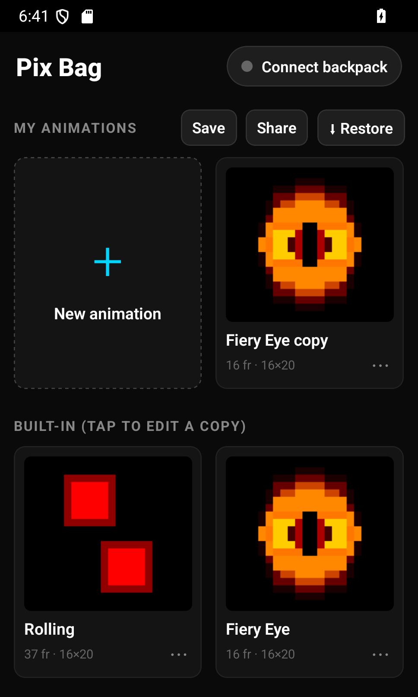
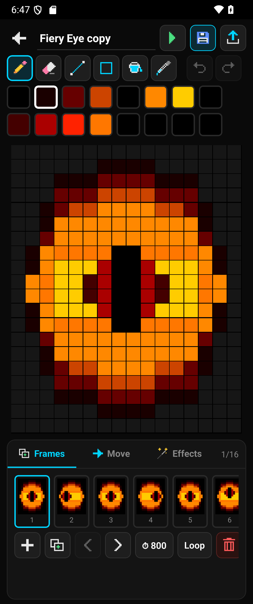
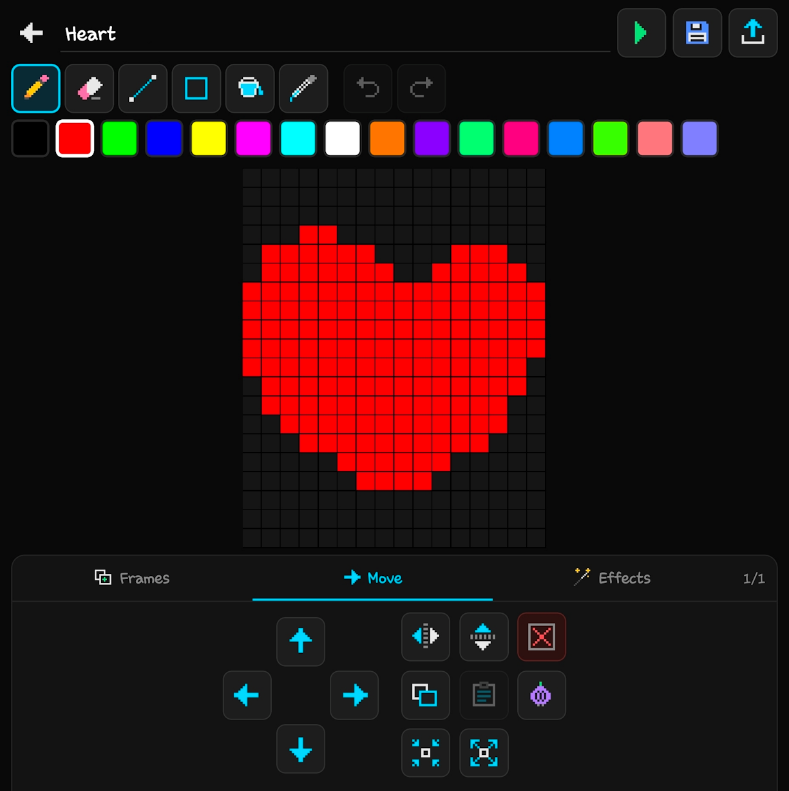
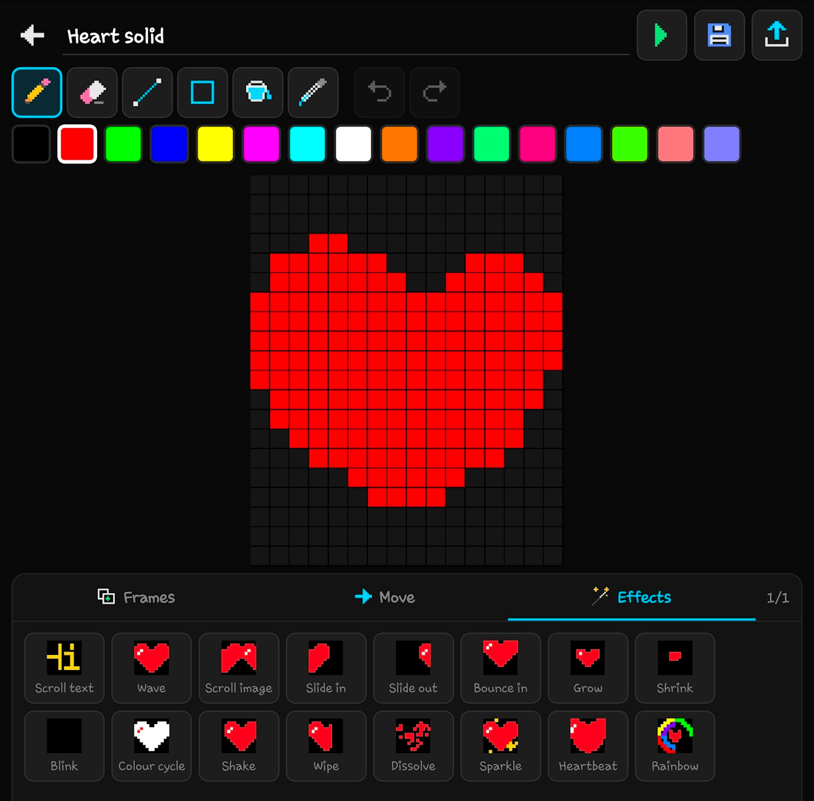
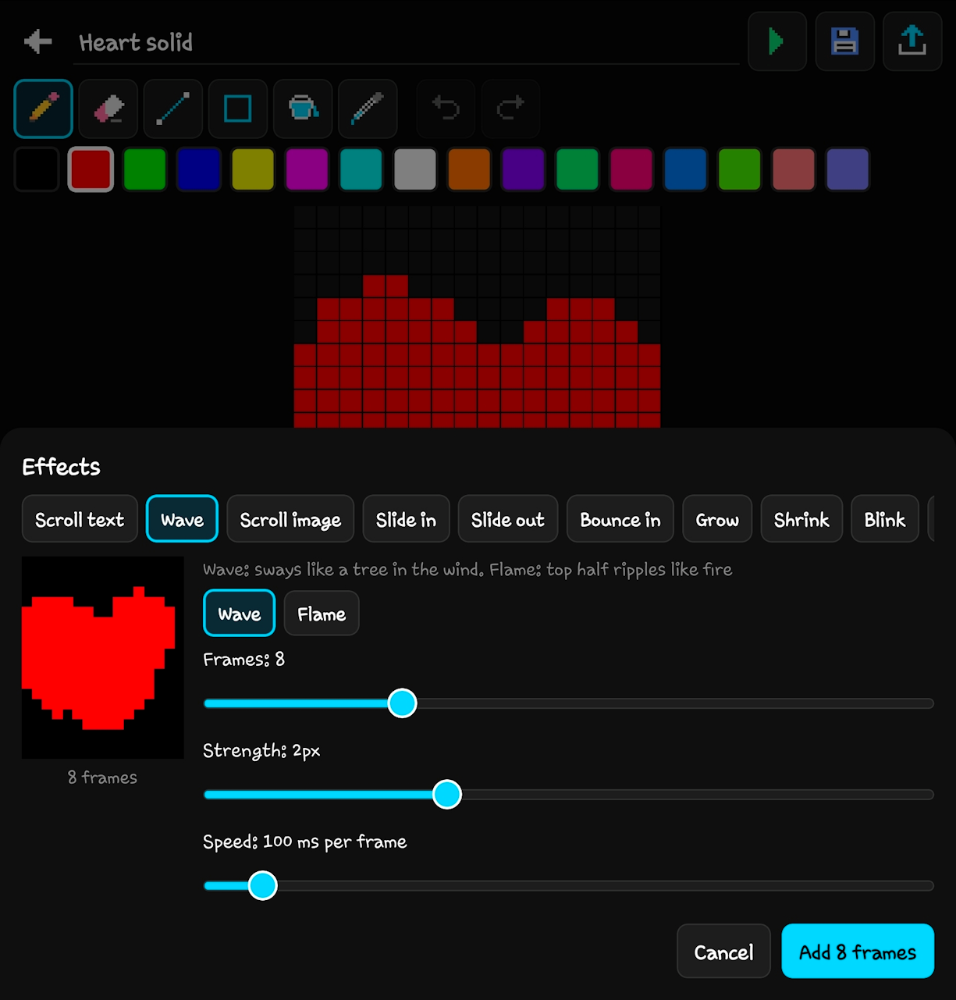
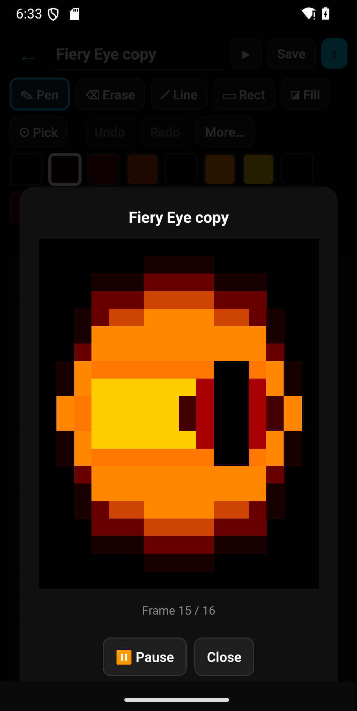
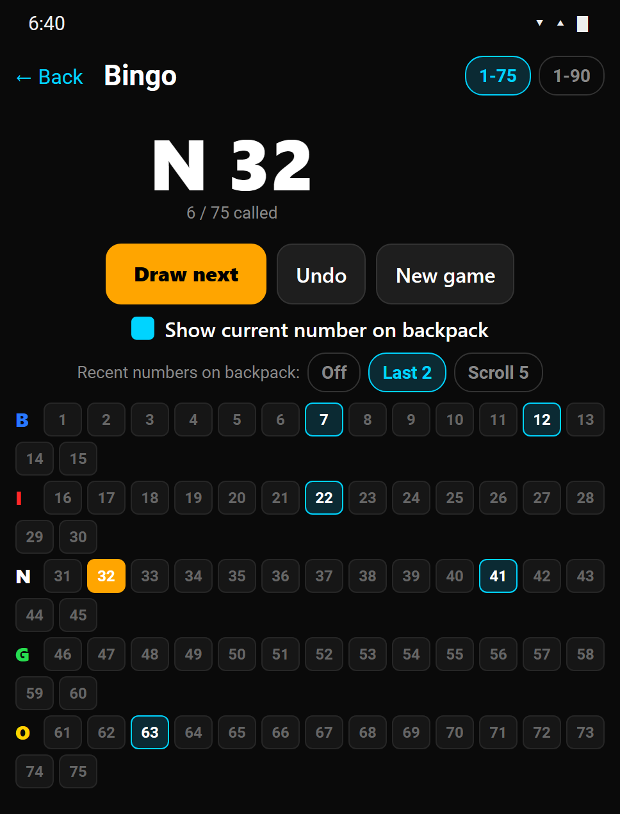

# Pix Bag user guide

Pix Bag lets you draw pixel animations on your phone and send them to your PIX LED backpack over Bluetooth. Everything is stored on your phone. No account is needed.

## Getting started

1. Switch the backpack on and turn on Bluetooth on your phone.
2. Open Pix Bag and tap the **Connect backpack** chip at the top right.
3. Tap **Scan for Backpacks** and allow the Bluetooth permission if asked. Scanning runs for about 10 seconds.
4. Tap your backpack in the list.

Next time, the Device page shows **Reconnect to &lt;name&gt;** so you can connect with one tap, without scanning.

The chip shows the connection state: grey = not connected, green = connected, red = link lost. If the link drops, Pix Bag tries to reconnect on its own. Otherwise open the Device page and tap **Reconnect**.

## Gallery

The home screen lists **My animations** and the **Built-in** animations.

- Tap **+ New animation** to start a blank one.
- Tap an animation to edit it. Built-ins open as a copy, so the original stays as it is.
- Tap `⋯` (or long-press the card) for more: **Edit**, **Preview**, **Upload to backpack**, and for your own animations **Duplicate** and **Delete**.
- **Save**, **Share** and **Restore** back up all your animations (see [Backup & restore](#backup--restore)).

## Editor

The top bar has the name (tap to rename) and three icon buttons: **▶ Preview**, **Save** (highlighted while there are unsaved changes) and **Upload**. Every button in the editor is an icon: **long-press any icon to see its name**.

Below that are the drawing tools, then the palette, the canvas, and a tray with three tabs: **Frames**, **Move** and **Effects**. The canvas always stays visible, so you see each change as you make it. On a wide screen (for example an unfolded foldable) the tools, palette and tray move to a side panel.

### Drawing tools

| Icon | Tool | What it does |
| ---- | ---- | ------------ |
| pencil | Pen | Draw with the selected colour. Drag to draw lines |
| eraser | Eraser | Paint with the first palette slot (normally black = LED off) |
| diagonal line | Line | Drag from start to end point |
| square | Rectangle | Drag corner to corner for a rectangle outline |
| bucket | Fill | Fill the touched area with the selected colour |
| eyedropper | Pick | Tap a pixel to select its colour, then you're back on the pen |
| curved arrows | Undo / Redo | Step back or forward through the last 100 changes |

## Palette

Each animation has up to 16 colours.

- Tap a swatch to draw with it.
- Long-press a swatch to change it: hue, saturation and brightness sliders, a hex field, and quick colours. Tap **OK** to apply.
- Tap **+** to add a slot (shown while there are fewer than 16).

The first slot is what the eraser paints, and blank pixels use it too. Keep it black if you want those LEDs off.

## Frames tab

The strip shows every frame with a live thumbnail. Tap one to edit it. The counter on the tab bar shows which frame you're on.

- **+** adds a blank frame after the current one (or tap the dashed **+** tile).
- **Duplicate** copies the current frame.
- **‹ ›** move the current frame earlier or later.
- **⏱ 500** sets how long the frame is shown (in milliseconds).
- **Loop** (or the current direction) cycles the playback direction: **Loop**, **Ping-pong** (forward then back), **Play once**, **Ping-pong once**. Older backpack firmware may loop the "once" directions anyway.
- **Bin** deletes the current frame. With only one frame left, it clears it instead.

In the duration dialog, use the slider (20 to 3000 ms) or a preset, then tap **This frame** or **All frames**.

## Move tab

- **Arrow pad**: shift the picture one pixel. Pixels that fall off one edge come back on the other.
- **Flip horizontal / vertical**: mirror the current frame.
- **Clear** (red ×): blank the current frame.
- **Copy / Paste**: copy a frame and paste it over another, even in a different animation. Colours that aren't in the target palette are added, or matched to the nearest colour when the palette is full. Paste is greyed out until you've copied something.
- **Onion skin**: show the previous frame faintly behind the current one.
- **Shrink / Expand** (arrows pointing in / out): make the drawing 2 pixels smaller or bigger around its centre. Repeated resizing loses detail, but Undo brings it back.

Every change here can be undone.

## Effects tab

Effects generate animation frames from the current frame. Each button replays its effect on a little heart every few seconds, so you can see what it does. Tap one to open its options with a live preview, then **Add N frames**: the new frames go right after the current frame. Use Undo to take them out again.

| Effect | What it does | Options |
| ------ | ------------ | ------- |
| Scroll text | Your text scrolls across the display in the backpack's font | text, colour, over the image or on black, start off or on screen, step |
| Wave | **Wave**: the image rocks around its base like a tree in the wind. **Flame**: the top half ripples like fire | style, frames, strength |
| Scroll image | The image loops round the screen | direction, step |
| Slide in / Slide out | The image slides in from / out to an edge | direction, frames |
| Bounce in | Drops in from the top and bounces | frames |
| Grow / Shrink | Zooms in from / out to the centre | frames |
| Blink | On / off | |
| Colour cycle | Each colour in the image passes to the next one every frame, like chasing lights | |
| Shake | Quick jiggle | frames, strength |
| Wipe | The image appears or disappears line by line | in / out, direction, frames |
| Dissolve | The image breaks up (or builds up) pixel by pixel | out / in, frames |
| Sparkle | Little stars twinkle on the empty pixels around the image | colour, frames |
| Heartbeat | Double pulse | |
| Rainbow | **Swirl**: two rainbow rings spin around the image. **Spiral**: rainbow bands spin behind it. Always drawn behind your picture | style, ring gaps black / white, frames |

All effects also have a **Speed** slider (milliseconds per frame). Rainbow adds rainbow colours to your palette if there's room; when the palette is full it uses the closest colours already there.

## Preview, save, upload

- **▶ Preview** shows the animation with its timing and playback direction. Tap **Pause** / **Play**, or **Restart** after a "once" animation ends.

- **Save** stores the animation on your phone (and closes the keyboard if you were typing the name). If you leave with unsaved changes, Pix Bag asks whether to **Save** or **Discard**.
- **Upload** sends the animation to the backpack and switches it to Animation mode. The backpack keeps it after power-off. If no backpack is connected, Pix Bag offers to connect first. You get a warning if the animation size doesn't match the backpack, and an error if it has more frames than the backpack can hold.

The editor stays open while you visit the Device page, so you can connect in the middle of editing without losing work.

## Device page & modes

Tap the chip at the top right while connected.

 Illustration: your backpack's name, frame count and firmware version will differ.

- **Header**: backpack name, display size, maximum frames and firmware version.
- **Brightness**: drag the slider, use **−** / **+** (10% steps), or **Off**, **50%**, **Max**.
- **Display**: **Animation** shows your uploaded animation; **Off** switches the display off.
- **Widgets** (each opens its own screen):
  - **Clock**: check the preview time, adjust the UTC offset with − / + if it's wrong, then set the clock.
  - **Countdown**: set minutes and seconds, then start.
  - **Stopwatch**: **Start**, **Stop**, **Lap**, **Reset**. The time runs on the backpack.
  - **Scrolling Text**: type a message, pick a colour and a speed and send it. Characters the backpack can't show are listed.
  - **Roll the Dice**: plays a rolling animation and shows a random result. Tap again to re-roll.
  - **Bingo**: see [Bingo](#bingo).
  - **Bike**: **Left** / **Right** turn signals, **Stop / Brake**, **Off / Idle**.
- **Games**: **Pix Blocks**, **Crawler** and **Pixel Breaker** open a game pad. Hold a button to repeat it.
- **Device**: **Restart** the backpack. **Demo: On/Off** appears if the backpack supports it.
- **Diagnostics**: **Upload Solid Red (test)** replaces the animation on the backpack with a plain red frame, to check that uploads work.
- **Disconnect** ends the connection.

> **Firmware note:** many widgets and games need newer backpack firmware; Pix Bag greys out the ones your backpack can't run and shows its firmware version. Minimums: Clock and Bike 2.2.1; Countdown, Stopwatch and Pix Blocks 2.2.5; Roll the Dice and Crawler 2.3.2; Pixel Breaker 2.4.1. Animation, Off, Scrolling Text and Bingo work on any version. Firmware updates came from the original maker's servers, which no longer exist, so a backpack can't be updated any more.

## Bingo

A bingo caller that also shows each number on the backpack.

- Choose **1-75** (B-I-N-G-O columns, colour-coded) or **1-90**. Switching starts a new game.
- **Draw next** picks a random number that hasn't been called. You can also tap numbers on the board to mark (or unmark) them yourself.
- **Undo** takes back the last number; **New game** clears the board (it asks first).
- The board and called numbers are kept if you close the app.
- **Show current number on backpack** (on by default): the backpack shows the column letter on top, the number in its own font, and a sparkle at the top right for a few seconds after each new number. When you open Bingo, start a new game or undo back to an empty board, the backpack scrolls a colourful "Bingo" welcome.
- **Recent numbers on backpack**: **Off**, **Last 2** (two previous numbers in small digits at the bottom) or **Scroll 5** (the last five scroll past; takes a few seconds longer to send).

Bingo doesn't overwrite the animation saved on the backpack: after a power cycle it shows your own animation again.

## Backup & restore

On the Gallery:

- **Save** writes a `pixbag-backup-<date>.json` file with all your animations to a folder you choose (Downloads, My files, Google Drive, …) using the standard Android save dialog.
- **Share** sends the same file to another app (email, chat, Drive, …).
- **Restore** lets you pick a backup file, then choose:
  - **Merge**: adds animations you don't have yet and skips ones already there.
  - **Replace all**: deletes your current animations first.

Make a backup before uninstalling the app or switching phones. If you shared a backup through a chat app, the file is usually kept in that app's folder, for example `Android/media/com.whatsapp/WhatsApp/Media/WhatsApp Documents/Sent`.

## Tips & troubleshooting

- **No backpack found**: make sure it's switched on and close by, Bluetooth is on, and the permission was allowed. Close the original app or any other app that might be connected to the backpack, then scan again.
- **Link lost (red chip)**: open the Device page and tap **Reconnect**, or reconnect from the scan screen.
- **A widget or game is greyed out**: your backpack's firmware is too old for it (see the firmware note above).
- **Upload failed**: stay close to the backpack and try again. Very long animations take longer to send.
- **Size mismatch warning**: the animation was made for a different display size. You can still upload, but it may look wrong.
- **Erased pixels show a colour on the backpack**: the first palette slot isn't black. Long-press it and set it to black.
- **Want to change a built-in?** Tap it. You get a copy to edit and save.
- **Not sure what an icon does?** Long-press it.
